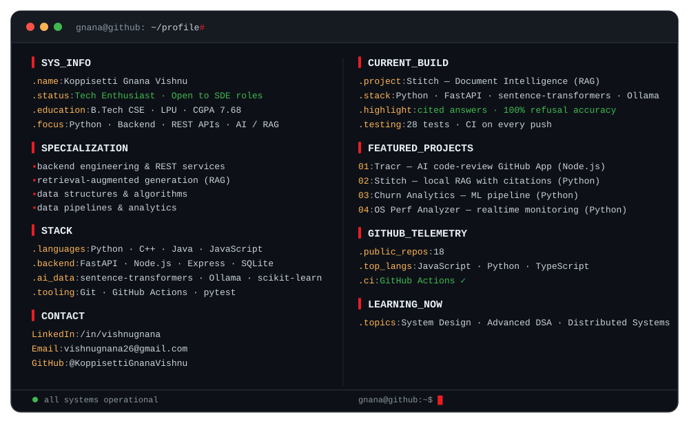

<!--
  GitHub Profile README for KoppisettiGnanaVishnu
  Upload BOTH files to the repo  KoppisettiGnanaVishnu/KoppisettiGnanaVishnu :
      README.md
      assets/dashboard.svg   <-- keep this exact path
  Regenerate the dashboard with:  python profile/build_dashboard.py
-->

  

---

## ⭐ Featured Projects

### 🔍 [Tracr](https://github.com/KoppisettiGnanaVishnu/tracr) — GitHub AI Code Review & Accountability Platform
A **GitHub App** that automates Pull Request analysis and security review of AI-assisted code changes.
- Detects security-sensitive patterns — hard-coded credentials, API keys, auth risks, unsafe SQL
- **0–100 Trust Score** + line-level review comments posted directly onto PRs

`Node.js` `Express` `SQLite` `Octokit` `GitHub Webhooks`

### 🧵 [Stitch](https://github.com/KoppisettiGnanaVishnu/Stitch-rag) — Enterprise Document Intelligence (RAG)
A fully local **Retrieval-Augmented Generation** system that answers questions **strictly from your documents** (PDF / DOCX / TXT), citing the exact source and page every time.
- Sentence chunking + transformer embeddings + a **persistent vector store** with similarity & MMR ranking
- **Trust layer** scoring confidence / groundedness / completeness, **refusing without evidence** — 100% refusal accuracy on benchmarks
- Test coverage with `pytest` · **CI on every push**

`Python` `FastAPI` `sentence-transformers` `Ollama` `NumPy` `pytest`

### 📉 [Customer Churn Analytics Platform](https://github.com/KoppisettiGnanaVishnu/Customer-Churn-Analytics-Platform)
End-to-end churn prediction & analytics pipeline. `Python` `SQL` `scikit-learn` `Power BI`

### ⚙️ [AI-Powered OS Process Performance Analyzer](https://github.com/KoppisettiGnanaVishnu/AI-powered-performance-Analyzer-for-OS-Processes)
Real-time monitoring, analysis and optimization of OS processes. `Python`

---

## 📊 GitHub Analytics

 

---

## 🌐 Connect With Me

---

<i>“I love building software that matters.”</i>
