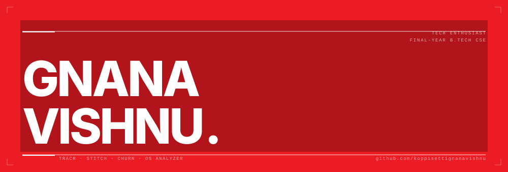

  

  <b>Tech Enthusiast</b> &nbsp;·&nbsp; Final-Year B.Tech CSE &nbsp;·&nbsp; Building &amp; learning in public

---

## Projects

### 01 · [Tracr](https://github.com/KoppisettiGnanaVishnu/tracr)

**AI code review for AI-generated pull requests.** Every PR is analysed, scored 0–100 for trust, and reviewed with line-level comments posted straight back to GitHub.

**The hard part** — telling *plausible* AI code apart from *correct* AI code, without burying the reviewer in noise.

`Node.js` · `Express` · `Octokit` · `SQLite`

### 02 · [Stitch](https://github.com/KoppisettiGnanaVishnu/Stitch-rag)

**Document intelligence that refuses to guess.** A fully local RAG system answering strictly from your PDF / DOCX / TXT files, with exact source and page citations. A trust layer scores confidence, groundedness and completeness — and it declines when the evidence isn't there.

**The hard part** — making *"I don't know"* a first-class answer instead of a failure mode.

`Python` · `sentence-transformers` · `Ollama` · `pytest`

`hit@3 100%` · `refusal 100%` · `citation 71%` · `~3.6 s` — reproducible with `python scripts/benchmark.py`

### 03 · [Customer Churn Analytics Platform](https://github.com/KoppisettiGnanaVishnu/Customer-Churn-Analytics-Platform)

**Churn prediction, end to end.** Cleaning, feature work, model training and an interactive dashboard that turns the predictions into something a business team can act on.

**The hard part** — keeping the model honest across class imbalance, and making the output legible to people who don't read confusion matrices.

`Python` · `SQL` · `scikit-learn` · `Power BI`

---

Also — [AI-Powered OS Performance Analyzer](https://github.com/KoppisettiGnanaVishnu/AI-powered-performance-Analyzer-for-OS-Processes): real-time monitoring and analysis of OS processes, in Python.

---

## Now

Taking **Stitch** from prototype to service: hybrid retrieval, cross-encoder reranking, and an evaluation harness that runs on every push. In parallel, system design and distributed systems.

## Certifications

**OCI 2025 — AI Foundations Associate** · Oracle 
Cloud Computing · NPTEL 
Software Engineering: Implementation & Testing · Coursera 
Computational Theory & Finite Automata · Infosys 
Bits and Bytes of Computer Networking · Coursera

---

## Contact

[`vishnugnana26@gmail.com`](mailto:vishnugnana26@gmail.com) &nbsp;·&nbsp; [LinkedIn](https://www.linkedin.com/in/vishnugnana) &nbsp;·&nbsp; [GitHub](https://github.com/KoppisettiGnanaVishnu)
