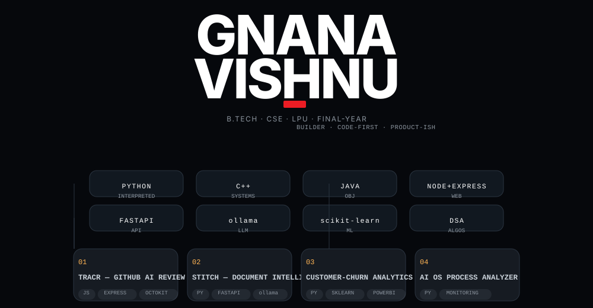

  

  <b>Tech Enthusiast</b> · Final-Year B.Tech CSE · Building &amp; learning in public

---

## ⭐ Featured Projects

### 🔍 [Tracr](https://github.com/KoppisettiGnanaVishnu/tracr) — GitHub AI Code Review & Accountability Platform

> Automates Pull Request analysis and security review of AI-assisted code, with a **0–100 trust score** and line-level review comments posted directly onto PRs.
>
> **Tech:** `Node.js` · `Express` · `Octokit` · `SQLite`

### 🧵 [Stitch](https://github.com/KoppisettiGnanaVishnu/Stitch-rag) — Enterprise Document Intelligence (RAG)

> A fully local RAG system that answers questions **strictly from your documents** (PDF / DOCX / TXT) with exact source and page citations. A trust layer scores confidence, groundedness and completeness and **refuses without evidence** — with a `pytest` suite and CI on every push.
>
> **Tech:** `Python` · `sentence-transformers` · `Ollama` · `pytest`

### 📉 [Customer Churn Analytics Platform](https://github.com/KoppisettiGnanaVishnu/Customer-Churn-Analytics-Platform)

> End-to-end churn prediction and analytics pipeline. `Python` · `SQL` · `scikit-learn` · `Power BI`

### ⚙️ [AI-Powered OS Performance Analyzer](https://github.com/KoppisettiGnanaVishnu/AI-powered-performance-Analyzer-for-OS-Processes)

> Real-time monitoring, analysis and optimization of OS processes. `Python`

---

## 📜 Certifications

| Certification | Issuer |
|:---|:---|
| **OCI 2025 — AI Foundations Associate** | Oracle |
| Cloud Computing | NPTEL |
| Computational Theory & Finite Automata | Infosys |
| Bits and Bytes of Computer Networking | Coursera |
| Software Engineering: Implementation & Testing | Coursera |

---

## 🌱 Currently Learning

`System Design` · `Advanced DSA` · `Distributed Systems` · `Scalable Backend Architecture`

---

<i>“I love building software that matters.”</i>
